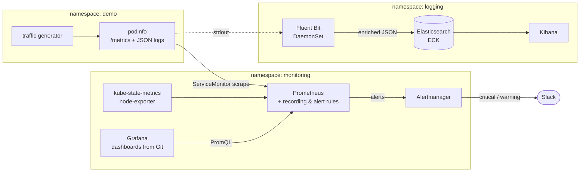

# k8s-observability-stack

Production-style **observability for Kubernetes**: metrics, dashboards, alerting and centralised logging, delivered as code and **tested end to end on a real cluster in every CI run**.

- **Metrics:** Prometheus (via the Prometheus Operator) with RED recording rules
- **Dashboards:** Grafana, provisioned from Git
- **Alerting:** unit-tested alert rules, Alertmanager routing to Slack, a runbook for every alert
- **Logging:** EFK, with Fluent Bit shipping enriched, structured container logs to Elasticsearch and Kibana (via ECK)


---

## What this solves

Most teams have *some* monitoring, but it was set up by hand, the alerts are noisy or never fire, and nobody knows whether they still work. This repo treats observability like application code:

- **Alerts are unit-tested.** `promtool` tests prove each alert fires when it should and stays quiet when it shouldn't, before it reaches production.
- **It's verified end to end.** CI builds a cluster, injects real failures, and checks that the alert fires and reaches Alertmanager, and that logs are searchable in Elasticsearch.
- **Alerts are actionable.** Every alert has a summary, a description and a runbook link, critical and warning alerts go to separate channels, and critical alerts suppress the matching warnings.
- **Dashboards are code.** They're versioned JSON in Git, loaded automatically, with no manual clicking in Grafana.

## Architecture



## Alerting

Rules live in [`prometheus/rules/app-alerts.rules.yaml`](prometheus/rules/app-alerts.rules.yaml) and use the **RED** method (Rate, Errors, Duration) through recording rules, so dashboards and alerts share the same definitions.

| Alert | Fires when | Severity |
|---|---|---|
| `HighErrorRate` | more than 5% of requests return 5xx for 2 min (ignores near-idle services) | critical |
| `HighLatencyP95` | p95 latency above 500 ms for 5 min | warning |
| `ServiceNoTraffic` | a scraped service gets 0 requests for 10 min | warning |
| `ContainerMemoryNearLimit` | above 90% of the memory limit for 5 min | warning |
| `PodRestartingFrequently` | more than 3 restarts in 15 min | warning |

Plus the community rule set that ships with kube-prometheus-stack (node, kubelet, workload health).

**Tested:** [`prometheus/tests/app-alerts.test.yaml`](prometheus/tests/app-alerts.test.yaml) covers firing *and* non-firing cases (for example, 1% errors and failures on a near-idle service must stay quiet), plus exact alert text and the recording-rule maths.

**Routing** ([`helm/kube-prometheus-stack-values.yaml`](helm/kube-prometheus-stack-values.yaml)): critical alerts go to `#alerts-critical`, re-notifying hourly; warnings go to `#alerts`; critical inhibits warning for the same service; the Watchdog heartbeat is split out for a dead-man's-switch. The Slack webhook comes from a Secret, never Git.

**Runbooks:** [`docs/runbooks.md`](docs/runbooks.md).

## Dashboards

[`k8s/monitoring/dashboards/service-red.json`](k8s/monitoring/dashboards/service-red.json) is a *Service RED overview*. Pick a namespace and service to see request rate by status code, error ratio against the alert threshold, p50/p95/p99 latency, the busiest paths, CPU and memory against limits, restarts, and firing alerts. The Grafana sidecar loads it from a ConfigMap, alongside the cluster dashboards that ship with kube-prometheus-stack.

## Logging (EFK)

- **Fluent Bit** (DaemonSet) tails every container log, parses CRI and Docker formats, merges JSON log lines into fields (for example `level`, `msg`), and adds Kubernetes metadata (namespace, pod, container, labels).
- **Elasticsearch** and **Kibana** are run by the **ECK operator**, which handles TLS, credentials and upgrades.
- Logs land in daily `k8s-logs-YYYY.MM.DD` indices. Pods can opt out with the `fluentbit.io/exclude: "true"` annotation.

## What CI proves

| Job | What it does |
|---|---|
| **rules, configs & manifests** | `promtool check` and `promtool test` on the alert rules, verifies the generated PrometheusRule is in sync, `amtool check-config`, dashboard JSON validation, kubeconform on all manifests, Trivy misconfiguration scan |
| **e2e metrics & alerting** | kind cluster + kube-prometheus-stack + demo app, then asserts: both pods are scraped, rules load, RED metrics are produced, the dashboard is provisioned, and that **injecting 40% HTTP 500s fires `HighErrorRate` and it arrives in Alertmanager** |
| **e2e logging** | kind cluster + ECK + Elasticsearch + Kibana + Fluent Bit + demo app, then asserts that logs from the `demo` namespace are indexed, JSON is parsed into fields, and Kubernetes metadata is attached |

Each e2e job writes its results to the run's **Summary** page.

## Run it locally

Needs Docker, [kind](https://kind.sigs.k8s.io/), kubectl and Helm (about 6 GB RAM free for the full stack).

```bash
make all            # kind cluster + monitoring + logging + demo app
make e2e-metrics    # optional: run the automated checks
make e2e-logging

# Trigger a real alert and watch it in Grafana and Alertmanager:
kubectl -n demo set env deploy/traffic-generator ERROR_PERCENT=40
```

Each install script prints the port-forward commands and credentials for Grafana, Prometheus, Alertmanager and Kibana. To send alerts to Slack, set `SLACK_WEBHOOK_URL` before `make monitoring`.

Changing alert rules: edit `prometheus/rules/`, add a test case in `prometheus/tests/`, run `make test-rules`, then `make render` to regenerate the PrometheusRule.

## Repository layout

```
.
├── prometheus/rules/          # alert + recording rules (source of truth)
├── prometheus/tests/          # promtool unit tests
├── helm/                      # values for kube-prometheus-stack and fluent-bit
├── k8s/monitoring/            # generated PrometheusRule + Grafana dashboards (JSON)
├── k8s/logging/               # ECK Elasticsearch + Kibana
├── k8s/demo-app/              # podinfo, ServiceMonitor, traffic generator
├── docs/runbooks.md           # one runbook per alert
├── scripts/                   # install, render and e2e scripts
└── .github/workflows/ci.yml
```

## Taking it to production

- Persistent storage for Prometheus (see the commented `storageSpec`) and Thanos or Grafana Mimir for long-term, multi-cluster metrics.
- 3-node Elasticsearch across zones, ILM policies for log retention, snapshots to S3 or Azure Blob.
- Grafana behind SSO (OIDC), with dashboards still managed from Git.
- SLO burn-rate alerts (for example with Sloth or Pyrra) for customer-facing services.

## Author

**Sharanabasava Shettar**: DevOps Engineer | CKA, CKAD

I build Kubernetes platforms with proper observability (Prometheus, Grafana, Alertmanager, EFK, New Relic) on AWS, Azure and GCP.
[LinkedIn](https://www.linkedin.com/in/sharan-shettar-0b699821a)

## License

[MIT](LICENSE)
